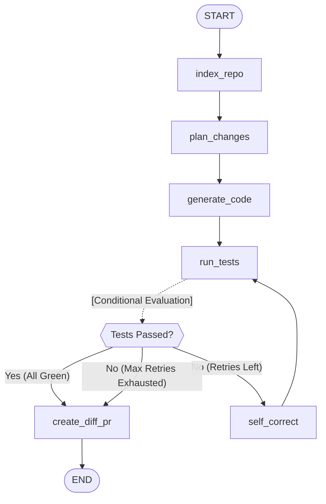

# 🤖 CodingBot: Autonomous Coding Agent Engine in Rust

<div align="center">

[](https://crates.io)
[](https://www.rust-lang.org/)
[](LICENSE)
[-brightgreen.svg?style=for-the-badge&logo=githubactions)](https://github.com)
[](https://github.com)

**An autonomous, self-healing software engineering agent built in pure, high-performance Rust.**  
*Indexes repositories • Plans architecture • Generates code • Runs test suites • Self-corrects on failures • Produces clean Git diffs and PRs*

[Key Features](#-key-features) •
[Architecture](#-architecture) •
[Quickstart](#-quickstart) •
[CLI Reference](#-cli-reference) •
[Self-Correction Cycle](#-the-self-correction-loop) •
[Rust API](#-rust-library-usage)

---

</div>

## 🌟 Overview

**CodingBot** is a production-grade autonomous coding agent runtime designed from the ground up in Rust. Rather than relying on simple linear scripts, CodingBot implements a **LangGraph-inspired cyclic directed state graph (`StateGraph`)**.

When tasked with implementing a feature or fixing a bug, CodingBot autonomously:
1. **Indexes the Git repository** — analyzes directory trees, file sizes, symbols, Git status, and auto-detects language and test harnesses (`cargo test`, `npm test`, `pytest`).
2. **Plans architectural modifications** — decomposes user instructions into structured milestones, touched files, and verification criteria.
3. **Generates and applies code patches** — writes safe, idiomatic changes directly into the repository workspace.
4. **Executes the test suite** — isolates compiler diagnostics, assertion failures, and runtime panics.
5. **Self-corrects iteratively** — feeds error diagnostics back into a repair node, re-synthesizes targeted patches, and re-executes tests up to a configurable retry limit.
6. **Produces deliverables** — creates a dedicated Git branch, commits changes, outputs unified Git diffs, and synthesizes a GitHub-ready Pull Request markdown document.

---

## 📐 Architecture & State Machine

CodingBot's execution is orchestrated by an asynchronous directed state machine with dynamic conditional branching:

```
                          ┌────────────────────────┐
                          │       [ START ]        │
                          └───────────┬────────────┘
                                      │
                                      ▼
                          ┌────────────────────────┐
                          │      index_repo        │
                          │   (AST, Git, Tests)    │
                          └───────────┬────────────┘
                                      │
                                      ▼
                          ┌────────────────────────┐
                          │      plan_changes      │
                          │ (Structured JSON Plan) │
                          └───────────┬────────────┘
                                      │
                                      ▼
                  ┌─────────► ┌────────────────────────┐
                  │           │     generate_code      │
                  │           │   (Filesystem Patch)   │
                  │           └───────────┬────────────┘
                  │                       │
                  │                       ▼
                  │           ┌────────────────────────┐
                  │           │       run_tests        │
                  │           │ (Spawn Suite, Sandbox) │
                  │           └───────────┬────────────┘
                  │                       │
                  │                       ▼
                  │             { evaluation_router }
                  │                       │
      [Tests Failed & Retries < Max]      │      [Tests Passed / Max Retries]
                  │                       │                   │
                  ▼                       │                   ▼
        ┌──────────────────┐              │         ┌──────────────────┐
        │   self_correct   │              │         │  create_diff_pr  │
        │ (Diagnose & Fix) │              │         │ (Git Diff & PR)  │
        └─────────┬────────┘              │         └─────────┬────────┘
                  │                       │                   │
                  └───────────────────────┘                   ▼
                                                    ┌──────────────────┐
                                                    │     [ END ]      │
                                                    └──────────────────┘
```

### Flowchart in Mermaid


---

## 🔁 The Self-Correction Loop

One of the biggest limitations of standard coding assistants is "one-shot generation" where compilation errors or subtle bugs require manual user intervention.

CodingBot solves this with its **Autonomous Self-Correction Cycle**:

```
 ┌────────────────────────────────────────────────────────────────────────┐
 │                      SELF-CORRECTION AUDIT CYCLE                       │
 ├────────────────────────────────────────────────────────────────────────┤
 │                                                                        │
 │   1. TEST FAILURE DETECTED:                                            │
 │      cargo test exited with code 101.                                  │
 │      stdout: assertion `left == right` failed                          │
 │      left:  0                                                          │
 │      right: 1                                                          │
 │      location: src/lib.rs:24:9                                         │
 │                                                                        │
 │   2. DIAGNOSTIC PARSER:                                                │
 │      Identifies ErrorType::Assertion on file src/lib.rs.               │
 │                                                                        │
 │   3. REPAIR NODE SYNTHESIS:                                            │
 │      Prompts LLM / Heuristic Engine with failure stacktrace,           │
 │      exact failing test inputs, and current file contents.             │
 │                                                                        │
 │   4. REPAIRED PATCH APPLICATION:                                       │
 │      Overwrites target file with bug fix and boundary guards.          │
 │                                                                        │
 │   5. CYCLE RE-ENTRY:                                                   │
 │      State machine transitions back to `run_tests` node.               │
 │      Result: test result: ok. 5 passed; 0 failed; finished in 0.01s    │
 │                                                                        │
 └────────────────────────────────────────────────────────────────────────┘
```

---

## ⚡ Quickstart

### Prerequisites
- [Rust & Cargo](https://rustup.rs/) (edition 2021 or 2024)
- Git installed on your system

### Installation
Clone this repository and build with Cargo:
```bash
git clone https://github.com/sutharson-k/codingbot.git
cd codingbot
cargo build --release
```

The compiled binary will be located at `target/release/codingbot` (or `target/release/codingbot.exe` on Windows).

---

## 🎮 Interactive CLI Commands

### 1. Instant Autonomous Demo
Runs an end-to-end autonomous demonstration in an isolated sandbox. It initializes a Git repository, introduces a task, deliberately injects an initial edge-case bug, detects the test failure, automatically self-corrects, passes the test suite, and outputs the Git diff and Pull Request preview:

```bash
cargo run -- demo
```

### 2. View State Machine Topology
Outputs the LangGraph ASCII diagram and Mermaid source:
```bash
cargo run -- graph
```

### 3. Run on a Target Repository
Execute CodingBot against any local repository:

```bash
# Offline deterministic mode (zero API keys needed)
cargo run -- run \
  --repo /path/to/my-project \
  --task "Implement LRU Cache with capacity limit and eviction unit tests" \
  --create-branch \
  --export-pr pr_description.md \
  --export-diff changes.patch
```

---

## 🔌 LLM Provider Support

CodingBot supports pluggable LLM backends:

| Provider | CLI Flag | Environment Variables | Description |
| :--- | :--- | :--- | :--- |
| **Heuristic Engine** | `--provider heuristic` | None (Default) | Built-in offline autonomous reasoning engine for tests, CI, and local development |
| **OpenAI** | `--provider openai` | `OPENAI_API_KEY`, `CODINGBOT_MODEL` | GPT-4o, GPT-4o-mini, o1, etc. |
| **Ollama** | `--provider openai` | `OPENAI_BASE_URL="http://localhost:11434/v1"` | Qwen2.5-Coder, DeepSeek-Coder, Llama-3, etc. |
| **DeepSeek / vLLM** | `--provider openai` | `OPENAI_BASE_URL`, `OPENAI_API_KEY` | DeepSeek-V3, DeepSeek-R1, custom endpoints |

### Example: Using Ollama for Local Offline Intelligence
```bash
export OPENAI_BASE_URL="http://localhost:11434/v1"
export OPENAI_API_KEY="ollama"
export CODINGBOT_MODEL="qwen2.5-coder:14b"

cargo run -- run \
  --repo ./my-service \
  --task "Add prometheus metrics endpoint and integration tests" \
  --provider openai
```

---

## 📖 CLI Reference

```
Autonomous coding agent workflow in Rust using a LangGraph-style state machine

Usage: codingbot <COMMAND>

Commands:
  run    Run the autonomous coding agent on a target repository
  demo   Run an end-to-end self-contained autonomous demo with simulated self-correction
  graph  Display the LangGraph state machine diagram and node topology
  help   Print this message or the help of the given subcommand(s)

Options:
  -h, --help     Print help
  -V, --version  Print version
```

### Options for `run`:
- `-r, --repo <PATH>`: Target repository directory (defaults to `.`)
- `-t, --task <TASK>`: Clear instruction/objective for the agent
- `-p, --provider <PROVIDER>`: Provider selection: `heuristic` or `openai`
- `--api-key <KEY>`: OpenAI / compatible API token (env: `OPENAI_API_KEY`)
- `--base-url <URL>`: API Base URL (env: `OPENAI_BASE_URL`)
- `-m, --model <MODEL>`: Model name (env: `CODINGBOT_MODEL`)
- `--test-cmd <CMD>`: Custom test suite command (e.g. `cargo test`, `npm test`)
- `--max-retries <N>`: Maximum self-correction attempts (default: `3`)
- `--create-branch`: Checkout a new Git branch and commit the verified result
- `--export-pr <PATH>`: Export the generated Pull Request Markdown to a file
- `--export-diff <PATH>`: Export the unified Git diff to a file

---

## 💻 Rust Library Usage

You can embed CodingBot's `StateGraph` engine directly into your own Rust services:

```rust
use std::sync::Arc;
use std::path::PathBuf;
use codingbot::agent::build_autonomous_coding_graph;
use codingbot::graph::state::AgentState;
use codingbot::llm::HeuristicEngine;

#[tokio::main]
async fn main() -> anyhow::Result<()> {
    // 1. Initialize LLM backend
    let llm = Arc::new(HeuristicEngine::new());

    // 2. Build the LangGraph-style workflow
    let graph = build_autonomous_coding_graph(llm);

    // 3. Define initial state
    let state = AgentState::new(
        PathBuf::from("./workspace"),
        "Add SHA-256 password hashing utility with tests",
        3, // max retries
    );

    // 4. Run the state graph
    let result = graph.run(state).await?;

    if result.is_successful {
        println!("Diff:\n{}", result.diff.unwrap_or_default());
        println!("PR Title: {}", result.pr_summary.unwrap().title);
    }

    Ok(())
}
```

---

## 🧪 Verification & Test Suite

All core capabilities are rigorously tested, including conditional looping, linear graph transitions, and the end-to-end self-correction cycle:

```bash
cargo test
```

Output:
```text
running 3 tests
test test_state_graph_basic_flow ... ok
test test_state_graph_conditional_loop ... ok
test test_autonomous_coding_cycle_end_to_end ... ok

test result: ok. 3 passed; 0 failed; 0 ignored; 0 measured; 0 filtered out; finished in 12.80s
```

---

## 📜 License

Distributed under the MIT License. See `LICENSE` for details.

---

<div align="center">

Built with ❤️ in Rust. Powered by LangGraph State Machine principles.

</div>
